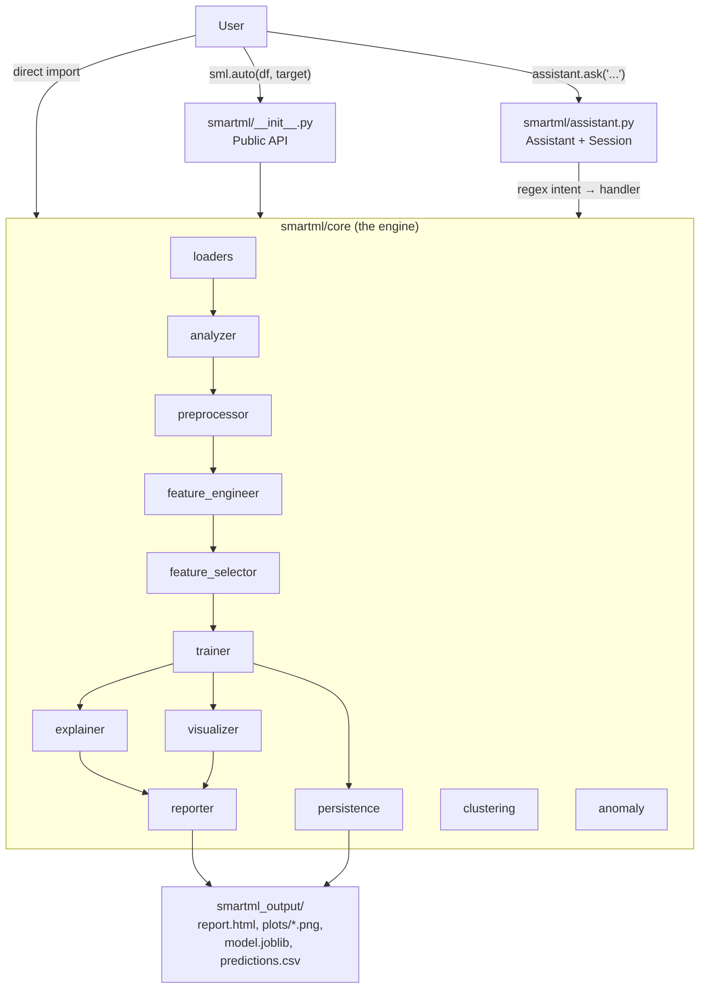
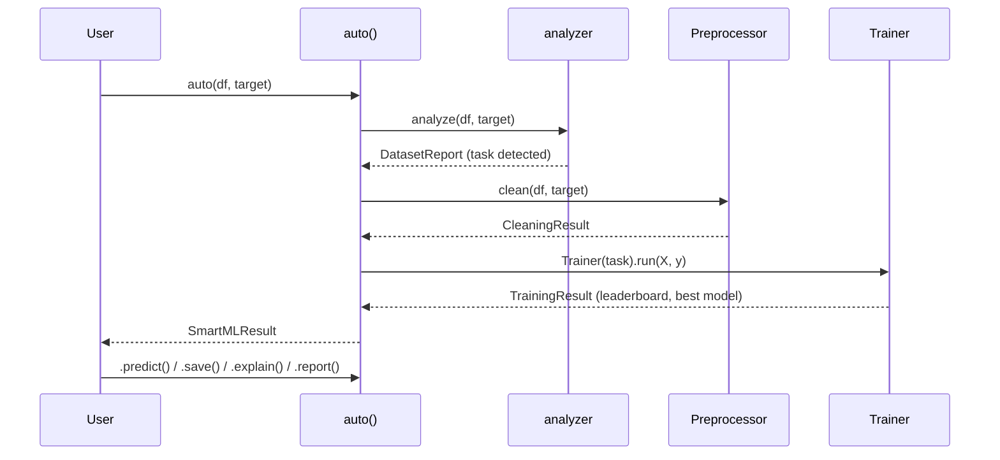

# SmartML Assistant — Complete Project Documentation

> **Package:** `smartml-assistant` · **Import name:** `smartml` · **Version:** 0.2.0 · **License:** MIT · **Python:** ≥ 3.10
>
> SmartML is an **AutoML library** for tabular data. You give it a pandas DataFrame and it profiles, cleans, engineers features, selects features, trains and compares 9–12 models, explains the winner, draws plots, writes reports, and saves the model. You can use it in three ways:
> 1. a **one-line API** (`sml.auto(df, target=...)`),
> 2. a **chat-style Assistant** (`assistant.ask("Train the best model")`),
> 3. the **low-level core modules** directly (`smartml.core.trainer.Trainer`, …).

---

## Table of Contents

1. [Workspace Layout](#1-workspace-layout)
2. [High-Level Architecture](#2-high-level-architecture)
3. [Installation & Dependencies](#3-installation--dependencies)
4. [Public API (`smartml/__init__.py`)](#4-public-api-smartml__init__py)
5. [Conversational Assistant (`smartml/assistant.py`)](#5-conversational-assistant-smartmlassistantpy)
6. [Core Engine Modules (`smartml/core/`)](#6-core-engine-modules-smartmlcore)
   - 6.1 [analyzer](#61-analyzerpy--dataset-profiling)
   - 6.2 [preprocessor](#62-preprocessorpy--auto-cleaning)
   - 6.3 [feature_engineer](#63-feature_engineerpy--feature-generation)
   - 6.4 [feature_selector](#64-feature_selectorpy--feature-selection)
   - 6.5 [trainer](#65-trainerpy--model-comparison)
   - 6.6 [explainer](#66-explainerpy--feature-importance)
   - 6.7 [clustering](#67-clusteringpy--unsupervised-clustering)
   - 6.8 [anomaly](#68-anomalypy--anomaly-detection)
   - 6.9 [visualizer](#69-visualizerpy--plots)
   - 6.10 [reporter](#610-reporterpy--htmlmarkdown-reports)
   - 6.11 [persistence](#611-persistencepy--save--load)
   - 6.12 [loaders](#612-loaderspy--data-ingestion)
7. [End-to-End Data Flow](#7-end-to-end-data-flow)
8. [Tests](#8-tests)
9. [Examples & Scripts](#9-examples--scripts)
10. [Generated Output](#10-generated-output)
11. [Project Docs & Metadata Files](#11-project-docs--metadata-files)
12. [Known Bugs, Limitations & Doc Mismatches](#12-known-bugs-limitations--doc-mismatches)
13. [Recommended Fixes / Roadmap](#13-recommended-fixes--roadmap)
14. [Quick Reference Cheat-Sheet](#14-quick-reference-cheat-sheet)

---

## 1. Workspace Layout

```
f:\smartml_assistant_module\
├── smartml_output\                 ← output from an earlier run (copy of the one below)
│   ├── report.html
│   └── plots\ (confusion_matrix.png, correlation_heatmap.png, model_comparison.png)
│
└── smartml_project\                ← THE ACTUAL PYTHON PROJECT
    ├── smartml\                    ← the importable package
    │   ├── __init__.py             (443 lines) public API: auto(), regression(), classification(),
    │   │                            clustering_pipeline(), load(), SmartMLResult
    │   ├── assistant.py            (807 lines) Assistant + Session (natural-language layer)
    │   ├── py.typed                PEP 561 marker (package ships type hints)
    │   └── core\
    │       ├── __init__.py         re-exports the 12 sub-modules
    │       ├── analyzer.py         (403) dataset profiling, task detection, quality score
    │       ├── preprocessor.py     (185) dedupe, impute, encode, scale
    │       ├── feature_engineer.py (284) date parts, frequency enc., interactions, ratios
    │       ├── feature_selector.py (296) variance, correlation, SelectKBest, RF-importance
    │       ├── trainer.py          (443) multi-model CV leaderboard
    │       ├── explainer.py        (65)  feature importance + narrative
    │       ├── clustering.py       (346) KMeans / MiniBatch / DBSCAN / Agglomerative / GMM
    │       ├── anomaly.py          (274) IsolationForest / LOF / OneClassSVM / EllipticEnvelope
    │       ├── visualizer.py       (459) 10 matplotlib plot functions
    │       ├── reporter.py         (157) HTML + Markdown report builders
    │       ├── persistence.py      (113) joblib save/load of model bundles
    │       └── loaders.py          (166) CSV/TSV/Excel/JSON/Parquet/Feather/ORC/SQL
    │
    ├── tests\                      8 files, 36 tests (pytest)
    ├── examples\                   3 runnable demo scripts
    ├── run_sample.py               Wine-dataset demo of the Assistant
    ├── tes.py                      scratch file (2 import lines only)
    ├── dist\                       built wheel + sdist for v0.2.0
    ├── smartml_assistant.egg-info\ setuptools build metadata
    ├── smartml_output\             output of run_sample.py
    ├── .mypy_cache\ .pytest_cache\ tool caches
    ├── pyproject.toml              build config + dependencies
    ├── README.md  CHANGELOG.md  CONTRIBUTING.md  LICENSE  .gitignore
    └── ALGORITHMS_GUIDE.md         (614 lines) study guide for all 33 algorithms
```

**Size:** ~3,600 lines of library code + ~400 lines of tests.

---

## 2. High-Level Architecture



### Design principles (stated in the code docstrings)

| Principle | How it is implemented |
|---|---|
| **Honest replies** | Every Assistant reply is built from real computed results. If you ask "why did you choose X?" before training, it says it hasn't trained yet. |
| **Explainable intent routing** | Intent detection is plain regex (`_INTENT_PATTERNS`), not an ML classifier — fast, dependency-free, readable. |
| **Thin dispatcher** | The Assistant does no ML itself; all work lives in `smartml.core`, so everything is also available programmatically. |
| **Plain-English audit log** | Every cleaning / FE / selection / clustering step appends a human sentence to a `steps` list. |
| **Library-friendly** | Uses `logging.getLogger("smartml")` with a `NullHandler` (silent by default); no `print()`; matplotlib `Agg` backend is set lazily, not at import. |
| **Optional extras** | XGBoost / LightGBM / CatBoost are used only if installed (`try/except ImportError`). |

---

## 3. Installation & Dependencies

From [`pyproject.toml`](pyproject.toml):

```bash
pip install smartml-assistant            # core
pip install "smartml-assistant[all]"     # + boosting, optuna, shap, plotly, seaborn
pip install -e ".[all,dev]"              # development (adds pytest, pytest-cov)
```

| Group | Packages | Actually used in code? |
|---|---|---|
| **core** | pandas ≥2.0, numpy ≥1.24, scikit-learn ≥1.3, matplotlib ≥3.7, joblib ≥1.3 | ✅ Yes |
| `boosting` | xgboost ≥2.0, lightgbm ≥4.0, catboost ≥1.2 | ✅ Yes (optional, in `trainer.py`) |
| `tuning` | optuna ≥3.0 | ❌ Not used anywhere |
| `explain` | shap ≥0.43 | ❌ Not used anywhere |
| `viz` | plotly ≥5.0, seaborn ≥0.12 | ❌ Not used anywhere |
| `dev` | pytest ≥7.4, pytest-cov ≥4.0 | ✅ Tests |
| *(implicit)* | pyarrow (Parquet/Feather/ORC), openpyxl (Excel), sqlalchemy (SQL strings) | Needed at runtime but **not declared** |

Pytest config: `testpaths = ["tests"]`, and it ignores `DeprecationWarning`, `PendingDeprecationWarning`, `FutureWarning`.

---

## 4. Public API (`smartml/__init__.py`)

Sets `__version__ = "0.2.0"` and attaches a `NullHandler` to the `"smartml"` logger.

### 4.1 Top-level functions

| Function | Signature | What it does |
|---|---|---|
| `auto` | `auto(data, target, output_dir="smartml_output", task=None) → SmartMLResult` | `analyze` → detect task → `Preprocessor.clean` → `Trainer.run`. **No feature engineering/selection.** |
| `regression` | `regression(data, target, output_dir=...)` | `auto(..., task="regression")` |
| `classification` | `classification(data, target, output_dir=...)` | `auto(..., task="classification")` |
| `clustering_pipeline` | `clustering_pipeline(data, algorithm="auto", n_clusters=None, output_dir=...)` | Runs `ClusteringTrainer`; returns `SmartMLResult(task="clustering")` |
| `load` | `load(path, **kwargs) → DataFrame` | Wrapper over `core.loaders.load` |

### 4.2 `SmartMLResult` class

A unified result wrapper.

| Attribute | Meaning |
|---|---|
| `task` | `"classification"`, `"regression"` or `"clustering"` |
| `training_result` | `TrainingResult` (None for clustering) |
| `cleaning_result` | `CleaningResult` |
| `dataset_report` | `DatasetReport` |
| `clustering_result` | `ClusteringResult` (None for supervised) |
| `output_dir`, `target` | as given |

| Method | Behaviour |
|---|---|
| `predict(data)` | Applies `Preprocessor.transform_new` (same impute/encode/scale) then `best_model.predict`. Returns a `pd.Series` named `"prediction"`. Raises `RuntimeError` for clustering results. |
| `save(path="smartml_model")` | `persistence.save_model(...)` → returns `*.joblib` path. |
| `explain()` | Returns the feature-importance narrative string. |
| `report(fmt="html")` | Builds a fake session object and calls `reporter.generate_html_report` / `generate_markdown_report` (`"markdown"` or `"md"`). No plots are included because the fake session has empty `visualizations`. |
| `__repr__` | e.g. `SmartMLResult(task='classification', best_model='Logistic Regression', cv_score=0.9932)` |

### 4.3 `__all__`

Exports `auto, regression, classification, clustering_pipeline, load, Assistant, Session, SmartMLResult` plus sub-modules `analyzer, preprocessor, feature_engineer, feature_selector, trainer, explainer, visualizer, reporter, persistence, loaders, clustering, anomaly`.
⚠️ `trainer` is listed but is actually imported as `trainer_mod` — see [§12](#12-known-bugs-limitations--doc-mismatches).

---

## 5. Conversational Assistant (`smartml/assistant.py`)

### 5.1 `Session` dataclass — all conversation state

| Field | Type | Filled by |
|---|---|---|
| `raw_df` | DataFrame | constructor (never mutated) |
| `target` | str \| None | constructor or "set target to X" |
| `output_dir` | str (`"smartml_output"`) | constructor; created in `__post_init__` |
| `dataset_report` | `DatasetReport` | analyze / set target / auto |
| `cleaning_result` | `CleaningResult` | clean |
| `feature_engineering_result` | `FeatureEngineeringResult` | engineer features |
| `feature_selection_result` | `FeatureSelectionResult` | select features |
| `training_result` | `TrainingResult` | train |
| `clustering_result` | `ClusteringResult` | cluster |
| `anomaly_result` | `AnomalyResult` | detect anomalies |
| `importance_result` | `ImportanceResult` | feature importance |
| `visualizations` | dict label → png path | visualize |
| `report_paths` | dict format → path | report |
| `loaded_bundle` | `SavedBundle` | load model |
| `history` | list of `{role, text, time}` | every `ask()` |

`__post_init__` creates the output folder and, if a target is given, runs `analyzer.analyze` immediately.

### 5.2 `Assistant` class

```python
assistant = sml.Assistant(df, target="Price", output_dir="smartml_output")
reply: str = assistant.ask("Train the best model", **context)
assistant.history          # list of all turns
```

- Raises `TypeError` if `df` is not a DataFrame.
- `_greet()` puts a first message in history, e.g. *"SmartML Assistant ready. Loaded a dataset with 151 rows and 6 columns (no target set yet …)"*.
- `ask(text, **context)`:
  1. logs the user turn,
  2. lowercases/strips the text,
  3. finds the **first** regex in `_INTENT_PATTERNS` that matches,
  4. calls the handler inside `try/except` (errors become a friendly message + `_log.exception`),
  5. logs the assistant turn and returns the reply.

**Supported `context` keywords:** `file_path=`, `data=` (DataFrame), `path=` (model file), `target=`, `format=`.

### 5.3 Intent routing table (order matters — first match wins)

| # | Regex (simplified) | Handler | Example phrases |
|---|---|---|---|
| 1 | `help`, `what can you do`, `list commands` | `_handle_help` | "help" |
| 2 | `set target`, `target is`, `target to`, `^target[=:]` | `_handle_set_target` | "set target to Price" |
| 3 | `clean`, `preprocess`, `fix … missing/nulls` | `_handle_clean` | "Clean my dataset" |
| 4 | `engineer…feature`, `create features` | `_handle_feature_engineer` | "Engineer some features" |
| 5 | `select…feature`, `reduce features` | `_handle_feature_select` | "Select features" |
| 6 | `analyze/analyse`, `summarize`, `describe the data`, `profile` | `_handle_analyze` | "Analyze the dataset" |
| 7 | `why … choose/pick/select`, `explain … choice/model`, `justify` | `_handle_explain_choice` | "Why did you choose this algorithm?" |
| 8 | `feature importan` | `_handle_feature_importance` | "Show feature importance" |
| 9 | `cluster` | `_handle_clustering` | "Cluster into 4 groups" |
| 10 | `anomaly`, `detect outliers`, `outlier detect` | `_handle_anomaly` | "Detect anomalies" |
| 11 | `predict`, `inference`, `score` | `_handle_predict` | "Predict on new.csv" |
| 12 | `save … model`, `export … model` | `_handle_save_model` | "Save the model" |
| 13 | `load … model` | `_handle_load_model` | "Load the model" |
| 14 | `visualize/plot/chart/show … heatmap/correlation/confusion/residual/comparison/importance/roc/pr curve` | `_handle_visualize` | "Show me the confusion matrix" |
| 15 | `visualize`, `plot`, `chart` | `_handle_visualize` | "Plot everything" |
| 16 | `generate/build/create/make/export … report`, `^report$` | `_handle_report` | "Generate a markdown report" |
| 17 | `train`, `find … model`, `build … model`, `best model`, `fit … model` | `_handle_train` | "Train the best regression model" |
| — | no match | `_handle_unknown` | "sing me a song" → suggestions |

Helper patterns:
- `_FORMAT_PATTERNS` — detects `pdf`, `markdown`/`md`, `html`, `docx`/`word` in report requests.
- `_TASK_OVERRIDE_PATTERNS` — `classif…` / `regress…` in a train request forces the task.
- `_PATH_RE` — finds a filename ending in `.csv .xls .xlsx .json .parquet .feather` inside the sentence.

### 5.4 What each handler does

| Handler | Behaviour |
|---|---|
| `_handle_help` | Static list of capabilities. |
| `_handle_set_target` | Uses `target=` context or regex-extracts the column name; validates it exists; re-runs `analyze`; replies with the task reason. Column names must match `[A-Za-z0-9_ ]+`. |
| `_handle_analyze` | Shape, memory, column-type counts, missing summary, duplicates, quality score/grade, constant / near-constant / high-cardinality columns, top-3 outlier columns, task reason. |
| `_handle_clean` | `Preprocessor().clean(raw_df, target)` → lists steps or "already clean". |
| `_handle_feature_engineer` | Auto-cleans first if needed, then `FeatureEngineer().fit_transform(cleaned_df, …)`. |
| `_handle_feature_select` | Auto-cleans first; uses engineered df if present; `FeatureSelector().select(X, y, task)`. |
| `_handle_train` | Requires target; auto-cleans; picks task (override → report → "classification"); chooses X from *selected* → *engineered* → *cleaned* data; `Trainer(task).run(X, y)`; prints the leaderboard with `← best` marker plus the reason. |
| `_handle_clustering` | Extracts an optional integer k from the sentence; `ClusteringTrainer(n_clusters=k).run(raw_df)`. |
| `_handle_anomaly` | `AnomalyDetector().detect(raw_df)` (IsolationForest, 5 % contamination). |
| `_handle_explain_choice` | Returns `training_result.best_reason`, or an honest "haven't trained yet". |
| `_handle_feature_importance` | `explainer.explain_feature_importance(...)`; top-10 list + narrative. |
| `_handle_visualize` | Parses keywords (`correlation`, `heatmap`, `importance`, `confusion`, `residual`, `comparison`, `roc`, `pr curve`/`precision`, `missing`, `distribut`). With no specific keyword: correlation heatmap + model comparison + confusion matrix (classification) or residuals (regression) + ROC (binary only). Plots go to `<output_dir>/plots/`. |
| `_handle_report` | Ensures a dataset report exists, auto-generates plots if a model exists, then writes HTML (default) or Markdown. PDF/DOCX are **not implemented** — an HTML report is written instead with an explanation. |
| `_handle_save_model` | `persistence.save_model` → `<output_dir>/model.joblib` (or `path=`). |
| `_handle_load_model` | Loads from `path=`, a filename in the text, or `<output_dir>/model.joblib`. |
| `_handle_predict` | Uses the trained model (or the loaded bundle if one was loaded); gets data from `data=`, `file_path=`, or a filename in the text; applies `Preprocessor.transform_new`; writes `<output_dir>/predictions.csv`; previews the first 5 predictions. |
| `_handle_unknown` | Suggests example commands. |

---

## 6. Core Engine Modules (`smartml/core/`)

### 6.1 `analyzer.py` — Dataset profiling

**`DatasetReport` dataclass** fields:

| Group | Fields |
|---|---|
| Shape | `n_rows`, `n_cols`, `memory_mb` |
| Column taxonomy | `numeric_cols`, `categorical_cols`, `datetime_cols`, `boolean_cols`, `text_cols` |
| Missing | `missing_counts`, `missing_pct`, `duplicate_rows` |
| Cardinality | `constant_cols`, `near_constant_cols` (≥95 % one value), `high_cardinality_cols` (> max(50, 50 % of rows)) |
| Distribution | `skewness`, `kurtosis` |
| Outliers | `outlier_counts` (1.5 × IQR rule) |
| Correlation | `correlations_with_target` (Pearson, numeric target only) |
| Quality | `data_quality_score` (0–100), `data_quality_grade` |
| Task | `target`, `task`, `task_reason`, `class_balance` |
| Properties | `total_missing`, `has_missing`, `missing_pct_total` |

**Column classification (`_split_columns`)**: bool → boolean; datetime64 → datetime; numeric → numeric; otherwise, if the average word count is > 4 → text, else categorical.

**Task detection (`detect_task`)** — rules in order:

1. Boolean target → binary classification
2. Non-numeric, 2 unique → binary classification
3. Non-numeric, > 2 unique → multi-class classification
4. Numeric with exactly 2 unique → binary classification
5. Numeric with ≤ 20 unique **and** unique/rows < 5 % → multi-class classification
6. Otherwise → regression

**Data quality score** — start at 100, subtract:

| Issue | Penalty | Cap |
|---|---|---|
| Missing cells % | × 2 | −40 |
| Duplicate rows % | × 4 | −20 |
| Constant columns % | × 1.5 | −15 |
| Outlier cells % (numeric) | × 3 | −15 |
| Rows < 50 / < 200 | −10 / −5 | — |

Grades: **≥90 A+ 🌟**, ≥75 B 👍, ≥60 C ⚠️, ≥40 D 🔴, else F ❌.

---

### 6.2 `preprocessor.py` — Auto-cleaning

**`CleaningResult`**: `df`, `steps`, `feature_names`, `encoders`, `scaler`, `numeric_cols`, `categorical_cols`, `impute_values`.

**`Preprocessor.clean(df, target)`** pipeline:

| Step | Action | Logged sentence example |
|---|---|---|
| 1 | Drop exact duplicate rows (`reset_index(drop=True)`) | "Removed 2 duplicate row(s)." |
| 2 | Drop constant columns (except target) | "Dropped 1 constant column(s): ['id']." |
| 3a | Numeric NaN → **median** | "Imputed 4 missing value(s) in numeric column 'x' with the median (5.8)." |
| 3b | Categorical/boolean NaN → **mode** | "… with the most frequent value ('red')." |
| 3c | Rows with missing **target** are dropped (not imputed) | "Dropped 3 row(s) with missing target…" |
| 4 | Encode: ≤ 15 unique → **one-hot** (`pd.get_dummies`); > 15 → **OrdinalEncoder** (unknown → −1) | "One-hot encoded 'color' (3 categories -> 3 binary columns)." |
| 5 | **StandardScaler** on numeric feature columns (never the target) | "Standard-scaled 13 numeric feature column(s)…" |

The target column **stays inside** `result.df`.

**`Preprocessor.transform_new(df, cleaning)`** (static) applies the *already fitted* pipeline to new data: re-uses the impute values → one-hot aligned to training dummy columns → ordinal transform → scaler transform → adds missing columns as 0 → reorders to `feature_names`. It never refits.

> Not handled: datetime columns and free-text columns are neither encoded nor dropped.

---

### 6.3 `feature_engineer.py` — Feature generation

**`FeatureEngineer(poly_degree=2, max_poly_cols=8, max_ratio_pairs=10, freq_encode_threshold=50)`**

`fit_transform(df, target=None, datetime_cols=None, categorical_cols=None) → FeatureEngineeringResult(df, new_features, steps, frequency_maps)`

| Step | Transformation | New column names |
|---|---|---|
| 1 | Date decomposition | `{col}_year, _month, _day, _dayofweek, _hour, _quarter, _is_weekend` |
| 2 | Frequency encoding (2 ≤ unique ≤ 50) | `{col}_freq` (relative frequency) |
| 3 | Pairwise products of the first ≤ 8 numeric columns (if `poly_degree ≥ 2`) | `{a}_x_{b}` |
| 4 | Pairwise ratios (≤ 10 pairs, ÷0 → 0, ±inf → 0) | `{a}_div_{b}` |

`transform(df, result)` only re-applies **frequency maps** to unseen data (unseen category → 0.0). Despite its docstring, it does **not** recompute date/interaction/ratio features. Lag features are mentioned in the docstring but **not implemented**.

---

### 6.4 `feature_selector.py` — Feature selection

**`FeatureSelector(variance_threshold=0.01, correlation_threshold=0.95, k_best=None, model_based=False, random_state=42)`**

`select(X, y=None, task="classification") → FeatureSelectionResult(selected_features, dropped_features, steps, n_original, n_selected, reduction_pct)`

| Step | Runs when | Method |
|---|---|---|
| 1. Variance | always | `VarianceThreshold(0.01)` on numeric columns |
| 2. Correlation | always (≥ 2 numeric) | For pairs with \|r\| > 0.95, drop the one less correlated with a numeric `y`; otherwise drop the later column |
| 3. Univariate | `k_best` set and `y` given | `SelectKBest` with `mutual_info_classif` (classification) or `f_regression` (regression) |
| 4. Model-based | `model_based=True` and `y` given | RandomForest (100 trees); keep importance ≥ mean |

Each step is wrapped in `try/except` and silently skipped on error. Non-numeric columns are always kept.

---

### 6.5 `trainer.py` — Model comparison

**Candidate models (`_candidate_models`)**

| Classification (9 + 3 optional) | Regression (9 + 3 optional) |
|---|---|
| Logistic Regression (max_iter=1000) | Linear Regression |
| Random Forest (200 trees) | Ridge Regression |
| Extra Trees (200 trees) | Huber Regressor (max_iter=300) |
| Gradient Boosting | Random Forest (200 trees) |
| HistGradientBoosting | Extra Trees (200 trees) |
| Naive Bayes (Gaussian) | Gradient Boosting |
| SVM (`SVC(probability=True)`) | HistGradientBoosting |
| Ridge Classifier | SVR |
| K-Nearest Neighbors | K-Nearest Neighbors |
| *XGBoost, LightGBM, CatBoost (if installed)* | *XGBoost, LightGBM, CatBoost (if installed)* |

**`Trainer(task, random_state=42, cv=5, test_size=0.2)`** — raises `ValueError` for other tasks.

`run(X, y)` algorithm:
1. `train_test_split` 80/20 (stratified for classification).
2. Scoring: **`f1_weighted`** (classification) or **`r2`** (regression).
3. For classification, CV folds = `max(2, min(cv, smallest class count))`.
4. For each model: `cross_val_score` on the training split → `fit` → predict on the hold-out set. Failing models are logged at DEBUG level and skipped.
5. Test metrics:
   - classification: `accuracy`, `f1_weighted`, `roc_auc` (binary, or macro-OVO for multi-class)
   - regression: `r2`, `mae`, `rmse`, `mape` (%)
6. Sort by CV mean (descending). If every model fails → `RuntimeError`.
7. `_explain_choice` writes the reason: winner, CV ± std, margin over the runner-up, plus a family-specific sentence (tree ensemble / linear / KNN / SVM / Naive Bayes).

**Dataclasses:** `LeaderboardEntry(name, cv_score, cv_std, test_metrics, fit_time_s)` and `TrainingResult(task, leaderboard, best_name, best_model, best_reason, feature_names, X_test, y_test, scoring)`.

---

### 6.6 `explainer.py` — Feature importance

`explain_feature_importance(model, X_test, y_test, feature_names, task, random_state=42) → ImportanceResult(importances, method, narrative)`

Method priority:
1. `model.feature_importances_` → "native"
2. `model.coef_` → absolute coefficients (averaged over classes for multi-class)
3. otherwise `permutation_importance` (10 repeats; f1_weighted / r2)

Narrative example: *"The top 3 features ('color_intensity', 'proline', 'flavanoids') account for roughly 35.2% of the model's total feature importance, with 'color_intensity' being the single strongest predictor."*

---

### 6.7 `clustering.py` — Unsupervised clustering

**`ClusteringTrainer(algorithm="auto", n_clusters=None, k_range=(2, 10), random_state=42, scale=True)`**

`run(X)`: keeps numeric columns → fills NaN with median → StandardScaler → dispatches by algorithm.

| `algorithm` | Implementation | Auto-k strategy |
|---|---|---|
| `auto` / `kmeans` | `KMeans(n_init=10)` | best silhouette over k = 2…min(10, n/2) |
| `minibatch_kmeans` | `MiniBatchKMeans` | same |
| `dbscan` | `DBSCAN(min_samples=5)` | eps grid {0.3, 0.5, 0.8, 1.0, 1.5} by silhouette |
| `agglomerative` | `AgglomerativeClustering` | k picked with KMeans silhouette |
| `gmm` | `GaussianMixture` | lowest **BIC** |

Metrics: **silhouette** (↑), **Davies-Bouldin** (↓), **Calinski-Harabasz** (↑). DBSCAN noise points (−1) are excluded. Narrative quality bands: > 0.7 excellent, > 0.5 good, > 0.25 fair, else poor.

`ClusteringResult(algorithm, n_clusters, labels, silhouette, davies_bouldin, calinski_harabasz, model, narrative, steps)`.

---

### 6.8 `anomaly.py` — Anomaly detection

**`AnomalyDetector(algorithm="isolation_forest", contamination=0.05, random_state=42, scale=True)`**

| `algorithm` | Model | Notes |
|---|---|---|
| `isolation_forest` | `IsolationForest` | default |
| `lof` | `LocalOutlierFactor` | n_neighbors = min(20, max(2, n/10)) |
| `one_class_svm` | `OneClassSVM(rbf)` | nu = contamination clipped to [0.01, 0.5] |
| `elliptic_envelope` | `EllipticEnvelope` | falls back to IsolationForest on a singular covariance |
| `auto` | runs IF, LOF, EE | picks the one whose anomaly count is **closest to contamination × n** |

Labels: **+1 = inlier, −1 = outlier**. `AnomalyResult.anomaly_indices` gives row positions. Narrative bands: < 1 % clean, < 5 % typical, < 15 % moderate, else high.

---

### 6.9 `visualizer.py` — Plots

All functions call `_use_agg()` (switches to the Agg backend only when no display/`MPLBACKEND` is set), create the folder, save a PNG (dpi 130), close the figure, and return the path.

| Function | File written | Used by Assistant? |
|---|---|---|
| `plot_correlation_heatmap(df, out_dir)` | `correlation_heatmap.png` | ✅ |
| `plot_missing_heatmap(df, out_dir)` | `missing_heatmap.png` | ✅ ("missing") |
| `plot_feature_importance(importances, out_dir, top_n=15)` | `feature_importance.png` | ✅ ("importance") |
| `plot_confusion_matrix(y_true, y_pred, out_dir, labels=None)` | `confusion_matrix.png` | ✅ |
| `plot_residuals(y_true, y_pred, out_dir)` | `residual_plot.png` (2 panels) | ✅ |
| `plot_model_comparison(leaderboard, out_dir)` | `model_comparison.png` | ✅ |
| `plot_roc_curve(y_true, y_score, out_dir)` | `roc_curve.png` | ✅ (binary only) |
| `plot_pr_curve(y_true, y_score, out_dir)` | `pr_curve.png` | ❌ never called |
| `plot_learning_curve(model, X, y, out_dir, task, cv)` | `learning_curve.png` | ❌ never called |
| `plot_distribution(df, out_dir, max_cols=12)` | `distribution.png` | ✅ ("distribution") |

---

### 6.10 `reporter.py` — HTML/Markdown reports

- **`generate_html_report(session, out_path)`** — a single self-contained HTML file with inline CSS and **base64-embedded PNGs**. Sections: Dataset Summary, Cleaning Steps, Model Comparison table (best row highlighted green), Best Model + reason, Feature Importance (top 15), Visualizations.
- **`generate_markdown_report(session, out_path)`** — same sections as Markdown; images are listed as file paths, not embedded.
- `session` is duck-typed (needs `dataset_report`, `cleaning_result`, `training_result`, `target`, `visualizations`, `importance_result`).

---

### 6.11 `persistence.py` — Save / load

`SavedBundle(model, feature_names, target, task, encoders, scaler, saved_at, model_name, impute_values)` is serialized with **joblib**.

- `save_model(path, model, feature_names, target, task, encoders, scaler, model_name, impute_values=None)` — appends `.joblib`, creates folders, returns the path.
- `load_model(path)` — tries `path`, then `path + ".joblib"`.

> ⚠️ joblib/pickle files can execute code when loaded — only load models you trust.

---

### 6.12 `loaders.py` — Data ingestion

| Extension | Reader |
|---|---|
| `.csv` | `pd.read_csv` |
| `.tsv` | `pd.read_csv(sep="\t")` |
| `.xlsx`, `.xls` | `pd.read_excel` |
| `.json` | `pd.read_json` |
| `.parquet` | `pd.read_parquet` |
| `.feather`, `.ftr` | `pd.read_feather` |
| `.orc` | `pd.read_orc` |

- `load(path, **kwargs)` — `FileNotFoundError`, `ValueError` (unsupported extension), or `RuntimeError` (reader failed).
- `from_sql(query, connection, **kwargs)` — accepts a SQLAlchemy URL string or a DBAPI connection.
- `sniff_format(path)` — returns a friendly name such as `"Parquet"`.

---

## 7. End-to-End Data Flow

### 7.1 `sml.auto()`



### 7.2 Typical Assistant conversation

```
Assistant(df, target)      → Session created, analyze() runs
"Analyze the dataset"      → DatasetReport summary
"Clean my dataset"         → CleaningResult
"Engineer features"        → FeatureEngineeringResult     (optional)
"Select features"          → FeatureSelectionResult       (optional)
"Train the best model"     → TrainingResult + leaderboard
"Why did you choose…"      → best_reason
"Show feature importance"  → ImportanceResult
"Visualize"                → plots/*.png
"Generate a report"        → report.html
"Save the model"           → model.joblib
"Predict on new.csv"       → predictions.csv
```

---

## 8. Tests

36 tests in 8 files (`pytest tests/ -v`). The last cached run (`.pytest_cache/v/cache/lastfailed = {}`) recorded **no failures**.

**Fixtures (`conftest.py`):**
- `classification_df` — Iris (`target` renamed to `species`), 4 NaNs injected in `sepal length (cm)`, plus 1 duplicated row → 151 rows.
- `regression_df` — Diabetes (`target` renamed to `progression`), 4 NaNs in `bmi`.

| File | # | What it checks |
|---|---|---|
| `test_core.py` | 10 | task detection, missing/duplicate counts, cleaning, one-hot encoding, `transform_new` column alignment, classification & regression trainer, explainer, visualizer + persistence round-trip |
| `test_assistant.py` | 10 | greeting, set target, analyze, clean, full classification conversation (train → why → importance → confusion → report → save → predict), regression + residual plot, honest "haven't trained", predict without data, unknown intent, save → load → predict |
| `test_clustering.py` | 3 | KMeans k=3, auto finds k=4 on blobs, DBSCAN |
| `test_feature_engineering.py` | 4 | date parts, frequency encoding values, interaction/ratio values, `transform` with an unseen category |
| `test_feature_selection.py` | 3 | variance threshold, correlation filter, univariate SelectKBest |
| `test_loaders.py` | 4 | CSV, JSON, Parquet, unsupported extension |
| `test_public_api.py` | 2 | `sml.auto` + predict/explain/save/report; `sml.clustering_pipeline` |
| `conftest.py` | — | fixtures |

**Not covered by tests:** the anomaly module, `plot_pr_curve`, `plot_learning_curve`, `plot_distribution`, `plot_missing_heatmap`, the Markdown report, `from_sql`, feature engineering/selection *through the Assistant*, GMM/agglomerative clustering, prediction accuracy or label correctness.

---

## 9. Examples & Scripts

| File | Dataset | Demonstrates |
|---|---|---|
| `examples/example_usage.py` | Iris | Full Assistant conversation, then the same steps through the core modules |
| `examples/advanced_pipeline.py` | Breast Cancer | Programmatic pipeline: IsolationForest anomaly filtering → Preprocessor → FeatureEngineer → FeatureSelector(corr 0.9, model-based) → Trainer(cv=3) |
| `examples/clustering_example.py` | `make_blobs` (4 centers) | `sml.clustering_pipeline(algorithm="auto")` |
| `run_sample.py` | Wine | Assistant chat printed to the console (sets UTF-8 stdout for Windows emoji output) |
| `tes.py` | — | Scratch file with two import lines; safe to delete |

---

## 10. Generated Output

`smartml_project/smartml_output/` (copied to the workspace root `smartml_output/`) was produced by **`run_sample.py`** on the **Wine dataset** (generated 2026-07-09 11:55):

- 178 rows × 14 columns, target `target_class`, detected **multi-class classification** (3 classes, 1.7 % of rows)
- Cleaning: only "Standard-scaled 13 numeric feature columns" (the data was already clean)
- **Winner: Logistic Regression** — CV F1 0.9932 ± 0.0136, test accuracy 0.9722, beating SVM (0.9863) by 0.0069
- Top features: `color_intensity`, `proline`, `flavanoids` (~35 % of total importance)
- Plots: correlation heatmap, model comparison, confusion matrix

| Model | CV F1 | Test accuracy |
|---|---|---|
| **Logistic Regression** | **0.9932** | 0.9722 |
| SVM | 0.9863 | 0.9722 |
| Ridge Classifier | 0.9860 | 1.0000 |
| Random Forest | 0.9860 | 1.0000 |
| Extra Trees | 0.9789 | 1.0000 |
| Naive Bayes | 0.9720 | 0.9722 |
| Gradient Boosting | 0.9581 | 0.9444 |
| HistGradientBoosting | 0.9579 | 1.0000 |
| K-Nearest Neighbors | 0.9503 | 0.9722 |

> Note: `run_sample.py` asks *"Clean my dataset and do feature engineering"*, but only the **clean** handler runs because the first matching intent wins.

---

## 11. Project Docs & Metadata Files

| File | Content |
|---|---|
| `README.md` | Install, quick start (auto, clustering, Assistant), feature list |
| `CHANGELOG.md` | **0.1.0 (2026-06-25):** initial engine + Assistant. **0.2.0 (2026-06-30):** top-level API, FE / FS / clustering / anomaly / loaders modules, boosting models, more plots, logging instead of print, lazy Agg backend, `SavedBundle` mutable-default fix |
| `CONTRIBUTING.md` | Dev setup, pytest, PEP 8 + Google docstrings + type hints, how to add an algorithm (`_candidate_models` + `_explain_choice`) |
| `ALGORITHMS_GUIDE.md` | 614-line study guide: 12 classification, 12 regression, 5 clustering, 4 anomaly algorithms — analogy, math, example, pros/cons, YouTube suggestions, decision matrix |
| `LICENSE` | MIT, © 2026 SmartML Contributors |
| `.gitignore` | Python build/cache files, venvs, `smartml_output/` |
| `dist/` | `smartml_assistant-0.2.0-py3-none-any.whl`, `smartml_assistant-0.2.0.tar.gz` |
| `smartml/py.typed` | Marks the package as typed |

---

## 12. Known Bugs, Limitations & Doc Mismatches

### 🔴 Critical

**1. Labels get misaligned after cleaning (confirmed).**
`Preprocessor.clean` calls `drop_duplicates().reset_index(drop=True)` (and resets the index again when it drops missing-target rows). The callers then take labels from the **original** DataFrame by index:

```python
y = data.loc[cleaning.df.index, target]                    # __init__.py auto()
y = self.session.raw_df.loc[X.index, self.session.target]  # assistant.py _handle_train
y = self.session.raw_df.loc[df_work.index, ...]            # assistant.py _handle_feature_select
```

After a reset, row *i* of the cleaned data is no longer row *i* of the raw data. Verified with a small example:

```
cleaned y : ['a', 'b', 'c', 'd']
raw.loc y : ['a', 'a', 'b', 'c']   ← wrong labels
```

Any dataset with duplicates or missing targets trains on shifted labels. The tests miss this because they don't check accuracy. **Fix:** use `cleaning.df[target]`, since the target column is still inside the cleaned DataFrame.

**2. Data leakage in evaluation.** Imputation medians, encoders and the `StandardScaler` are fitted on the **full** dataset before `train_test_split`, so CV and test scores are slightly optimistic. A scikit-learn `Pipeline`/`ColumnTransformer` fitted inside each fold would fix this.

**3. Engineered features are not rebuilt at prediction time.** When you train after "engineer features", `feature_names` includes columns like `a_x_b` or `col_freq`. At predict time `transform_new` cannot recreate them and **fills them with 0**, so predictions are silently wrong. The FE result is also not saved in the model bundle.

**4. Datetime and free-text columns break training.** The preprocessor neither encodes nor drops them, so they reach the models as raw values and every model fails ("All candidate models failed").

### 🟠 Functional bugs

5. **FE through the Assistant can crash with categorical data.** `_handle_feature_engineer` passes the raw report's `categorical_cols` to `fit_transform` on the *cleaned* DataFrame, where those columns have already been one-hot encoded and removed → `KeyError` (caught and shown as "unexpected error"). FE also runs on already-scaled values.
6. **One intent per sentence.** "Clean my dataset and do feature engineering" only cleans. "Help me train a model" shows help. "Plot feature importance" goes to the importance handler, not the plot. "What's the score?" goes to **predict** (because of `\bscore\b`).
7. **Clustering and anomaly detection use the target column** (`raw_df` including the target) when called from the Assistant. The cluster handler also treats *any* number in the sentence as k.
8. **Stratified split crashes** if any class has only one sample (`train_test_split` raises before the try/except).
9. **`set target` regex** only accepts `[A-Za-z0-9_ ]`, so columns like `sepal length (cm)` must be passed as `target=`.
10. **`wants_pr` is parsed but never used**; `plot_pr_curve` and `plot_learning_curve` are dead code from the Assistant's point of view.
11. **HTML report doesn't escape text**, so column names or values containing `<`/`>` can break the page.
12. **Nested parallelism:** `cross_val_score(n_jobs=-1)` wraps models that also use `n_jobs=-1`, which can oversubscribe the CPU. `SVC(probability=True)` is slow on large data.
13. **XGBoost `use_label_encoder=False`** is deprecated in xgboost 2.x and causes warnings. XGBoost also fails on string labels; that failure is caught, so the model is just skipped.

### 🟡 Documentation / API mismatches (confirmed)

| Claim | Reality |
|---|---|
| `__init__` docstring: `sml.clustering(df)` | `sml.clustering` is a **module**, not a function → use `sml.clustering_pipeline(df)` |
| `__all__` contains `"trainer"` | `sml.trainer` does **not exist** (imported as `trainer_mod`), so `from smartml import *` raises `AttributeError` |
| loaders docstring: `sml.from_sql(...)` | Not exported; use `smartml.core.loaders.from_sql` |
| README: auto does "feature engineering" | `auto()` only does analyze → clean → train |
| anomaly docstring: auto "runs all four… median count" | Runs **three** (no OneClassSVM) and picks the one **closest to the expected count** |
| feature_engineer: "lag features" | Not implemented |
| `FeatureEngineer.transform` docstring: re-computes date/interaction features | Only re-applies frequency maps |
| core docstring: selector has "MI, RFE" | No RFE; MI is used only for classification `k_best` |
| pyproject extras `optuna`, `shap`, `plotly`, `seaborn` | Not used anywhere |
| PDF/DOCX reports (help text mentions formats) | Not implemented; falls back to HTML |
| `load_model` docstring "Raises FileNotFoundError" | Not raised explicitly (joblib raises its own error) |

### ⚪ Housekeeping

- `tes.py` is leftover scratch code.
- `smartml_output/` exists twice (root and project) and is gitignored.
- `.mypy_cache`, `.pytest_cache`, `dist/` and `*.egg-info` are build artifacts.
- `pyarrow`, `openpyxl` and `sqlalchemy` are needed for some loaders but not declared.
- Preprocessor high-cardinality threshold (15) differs from the analyzer's (max(50, 50 %)).

---

## 13. Recommended Fixes / Roadmap

| Priority | Fix |
|---|---|
| P0 | Use `cleaning.df[target]` instead of `raw_df.loc[index, target]` (3 places). Add a test that checks accuracy on data with duplicates. |
| P0 | Handle datetime columns (decompose or drop) and text columns (drop or TF-IDF) in `Preprocessor`. |
| P1 | Build a real `sklearn.Pipeline` (impute → encode → scale → model) so it is fitted only on training folds and persisted as one object. |
| P1 | Store `FeatureEngineeringResult` and selected features in `SavedBundle`, and apply them in `predict`. |
| P1 | Make `_handle_feature_engineer` use the cleaned DataFrame's actual column types. |
| P2 | Fix `__all__` (`trainer`), the docstrings (`sml.clustering`, `sml.from_sql`), and the README `auto()` claim. |
| P2 | Exclude the target from clustering/anomaly runs in the Assistant. |
| P2 | Support multi-intent sentences (split on "and"/"then") and make the `score` intent stricter. |
| P2 | Wire up PR curves and learning curves; `html.escape` report text. |
| P3 | Use the declared extras (Optuna tuning, SHAP explanations) or remove them from `pyproject.toml`. |
| P3 | Add tests for anomaly detection, GMM/agglomerative clustering, Markdown reports and SQL loading. |

---

## 14. Quick Reference Cheat-Sheet

```python
import smartml as sml

# ---------- Load ----------
df = sml.load("data.csv")                      # csv/tsv/xlsx/json/parquet/feather/orc

# ---------- One-liner ----------
res = sml.auto(df, target="Price")             # or sml.regression / sml.classification
print(res)                                     # SmartMLResult(task=..., best_model=..., cv_score=...)
res.predict(new_df)                            # pd.Series
res.explain()                                  # narrative string
res.save("my_model")                           # -> my_model.joblib
res.report(fmt="html")                         # or "markdown"

# ---------- Clustering ----------
cl = sml.clustering_pipeline(df, algorithm="gmm", n_clusters=None)
cl.clustering_result.labels, cl.clustering_result.silhouette

# ---------- Assistant ----------
a = sml.Assistant(df, target="Price", output_dir="out")
a.ask("help")
a.ask("analyze the dataset")
a.ask("clean my dataset")
a.ask("engineer features")
a.ask("select features")
a.ask("train the best regression model")
a.ask("why did you choose this algorithm?")
a.ask("show feature importance")
a.ask("plot the residuals")
a.ask("generate a markdown report")
a.ask("save the model")
a.ask("load the model", path="out/model.joblib")
a.ask("predict", file_path="new.csv")          # or data=new_df
a.ask("cluster into 4 groups")
a.ask("detect anomalies")
a.history

# ---------- Low-level ----------
from smartml.core import analyzer, preprocessor, feature_engineer, feature_selector, trainer, explainer
rep = analyzer.analyze(df, target="Price")
cln = preprocessor.Preprocessor().clean(df, target="Price")
fe  = feature_engineer.FeatureEngineer().fit_transform(cln.df, target="Price")
fs  = feature_selector.FeatureSelector(k_best=20, model_based=True).select(X, y, task="regression")
tr  = trainer.Trainer(task="regression", cv=5).run(X, y)
imp = explainer.explain_feature_importance(tr.best_model, tr.X_test, tr.y_test, tr.feature_names, "regression")

from smartml.core.anomaly import AnomalyDetector
AnomalyDetector(algorithm="auto", contamination=0.05).detect(df)
```

---

*This document was produced by reading every source, test, example and configuration file in the workspace. Two behaviours (label misalignment and the API export mismatches) were checked by running code.*
